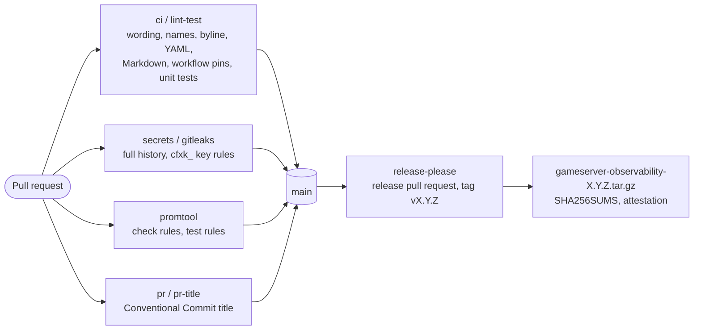

<!-- header:begin: the project page on luminare.tech drops this block, because the page has its own heading -->
<picture>
  <source media="(prefers-color-scheme: dark)" srcset="docs/brand/readme-header-dark.svg">
  <source media="(prefers-color-scheme: light)" srcset="docs/brand/readme-header-light.svg">
  
</picture>

<!-- byline:studio -->
*a [Luminare Development](https://luminare.tech/open-source/gameserver-observability/) open-source project*
<!-- /byline:studio -->
<!-- byline:personal
*by ItsPaulAT · [project page](https://luminare.tech/open-source/gameserver-observability/)*
/byline:personal -->
<!-- header:end -->

# gameserver-observability

Metrics, dashboards and alerts collected from outside the server process, for FiveM/RedM servers (FXServer).

[](https://github.com/luminare-dev/gameserver-observability/actions/workflows/ci.yml)
[](https://github.com/luminare-dev/gameserver-observability/releases)
[](LICENSE)
[](https://scorecard.dev/viewer/?uri=github.com/luminare-dev/gameserver-observability)

## Why

FXServer, the server of FiveM and RedM, serves performance metrics on `/perf/` and its status as
JSON (`info.json`, `dynamic.json`) on the game port. Turning them into alerts and dashboards
usually means writing scrape configs, PromQL and panels by hand, and it is easy to collect more
than needed, such as player names or identifiers. This pack is built to do it from outside the
server process, with no resource running inside the game server and with player counts only.
So far the repository holds its tested setup: CI with a promtool job, a secret scan that knows
game-server license keys, release automation and the decision records; the configs, rules and
dashboards are not in it yet (see [Limitations](#limitations)).

## Quickstart

```bash
git clone https://github.com/luminare-dev/gameserver-observability.git
cd gameserver-observability
bash scripts/test.sh
```

`scripts/test.sh` installs the hash-pinned test requirements into its own virtual environment and
runs the unit tests; it is the same command CI and the release build run. To check the rules
with promtool as CI does, see [Installation](docs/install.md).

## How it works



Every change runs through the checks on the left. Merging the release pull request tags the
version, and the same workflow run tests the tag, packs a `git archive` of it as the release
asset, writes `SHA256SUMS`, attests the archive (public repositories only) and publishes the
release. The archive holds every tracked file, so it is the pack tarball
([ADR 0005](docs/adr/0005-pack-layout-and-release-archive.md)).

What is in the repository today:

| Path | Content |
|---|---|
| `.github/workflows/` | CI (`ci.yml` with the `promtool` job), secret scan, pull request title check, release, OpenSSF Scorecard |
| `scripts/` | `test.sh` (the test command), `check_promtool.sh` (rule checks), and the template's checks for wording, names, byline, workflow pins and the release archive |
| `tests/` | unit tests for the scripts and for this repository's setup (`test_pack_repo.py`) |
| `docs/` | installation, configuration, upgrade, troubleshooting, runbook, toolchain pins and the ADRs |
| `requirements-*.txt` | hash-pinned Python packages for CI (`-dev`) and the tests (`-test`) |

## Design decisions

The decisions behind this project are recorded as short ADRs in [docs/adr/](docs/adr/):

- [ADR 0001: Record architecture decisions](docs/adr/0001-record-architecture-decisions.md)
- [ADR 0002: Pin every action and downloaded tool](docs/adr/0002-pin-actions-and-downloaded-tools.md)
- [ADR 0003: Secret scanning with the gitleaks binary](docs/adr/0003-secret-scanning-with-the-gitleaks-binary.md)
- [ADR 0004: Draft releases with checksums and provenance](docs/adr/0004-draft-releases-with-checksums-and-provenance.md)
- [ADR 0005: Plain files in a fixed layout, released as the source archive](docs/adr/0005-pack-layout-and-release-archive.md)
  (why plain files instead of generated bundles or container images)
- [ADR 0006: promtool from the official release tarball](docs/adr/0006-promtool-from-the-official-release-tarball.md)
  (why the pinned tarball instead of a container image or a setup action)
- [ADR 0007: One test script with hash-pinned requirements](docs/adr/0007-one-test-script-with-hash-pinned-requirements.md)
  (why one script for CI, the release and local runs instead of inline commands)
- [ADR 0008: Extra secret rule for any cfxk_ token](docs/adr/0008-extra-secret-rule-for-any-cfxk-token.md)
  (why a broader license-key rule instead of the template's rules alone)

## Supported versions

| Component | Tested with | Supported |
|---|---|---|
| promtool (rule checks in CI) | 3.15.0 | 3.15.0 (pinned in `ci.yml`) |
| Python (scripts and tests) | 3.10.22, 3.12.15, 3.14.3 | 3.10 or newer |

Fixes go into the latest minor release only. See the
[security policy](https://github.com/luminare-dev/.github/blob/main/SECURITY.md) for reporting.

## Limitations

- The pack itself is not in the repository yet: no scrape configs, exporter modules, recording or
  alerting rules, dashboards or demo stack. The `promtool` job and the release archive are set up
  for them; today the job finds no rule files and says so.
- Nothing here has been run against a real FXServer; that needs a server with a license key.
- There is no release yet. Build provenance attestations are only created for public
  repositories, so the first release is made after the repository is public.
- The `promtool` job is not one of the required checks yet (`ci / lint-test`, `secrets / gitleaks`,
  `pr / pr-title`, `DCO`); it is added to the ruleset after it has run on a pull request.

## Results

| What | Value | How it was measured |
|---|---|---|
| Unit tests | 116 run, 0 failed, 1 skipped; 19 of them test this repository's setup | `bash scripts/test.sh` with gitleaks 8.30.1 and markdownlint-cli2 0.23.2 on the `PATH`, Python 3.14.3, 2026-10-21 (the skipped test applies only to the template repository) |
| Unit tests, CI mode | 116 run, 0 failed, 2 skipped | `CI=true bash scripts/test.sh` without gitleaks on the `PATH`, Python 3.14.3, 2026-10-21: the script downloaded gitleaks 8.30.1 and checked its sha256, so the secret-rule tests ran (skipped: markdownlint-cli2 is not installed, and the template-only test) |
| Unit tests, other Pythons | 116 run, 0 failed, 10 skipped on each | `bash scripts/test.sh` on Python 3.10.22 and 3.12.15 (`python:3.10-slim`, `python:3.12-slim` plus git, without gitleaks and markdownlint-cli2), 2026-10-21 |
| Secret scan | 0 leaks in 2 commits | `gitleaks git --redact --config .gitleaks.toml .`, gitleaks 8.30.1, 2026-10-21 |
| Wording, name and placeholder check | 0 findings, 0 warnings | `python3 scripts/forbidden_words.py` in publish mode, 2026-10-21 |

## Documentation and links

- [Installation](docs/install.md) · [Configuration](docs/configuration.md) ·
  [Upgrade](docs/upgrade.md) · [Troubleshooting](docs/troubleshooting.md) ·
  [Runbook](docs/runbook.md) · [Toolchain and pins](docs/toolchain.md) · [ADRs](docs/adr/)
- Development: `bash scripts/test.sh` is the one command CI runs for the tests, and
  `bash scripts/check_promtool.sh` runs the rule checks of the `promtool` job (tools and versions:
  [Installation](docs/install.md), [Toolchain and pins](docs/toolchain.md))
- [Changelog](CHANGELOG.md) and [releases](https://github.com/luminare-dev/gameserver-observability/releases)
  (each release has `SHA256SUMS` and a build provenance attestation)
- [Contributing](https://github.com/luminare-dev/.github/blob/main/CONTRIBUTING.md) ·
  [Code of conduct](https://github.com/luminare-dev/.github/blob/main/CODE_OF_CONDUCT.md) ·
  [Security](https://github.com/luminare-dev/.github/blob/main/SECURITY.md) ·
  [Support](https://github.com/luminare-dev/.github/blob/main/SUPPORT.md)
- Project page: <https://luminare.tech/open-source/gameserver-observability/>

<!-- fxserver:begin -->
## Not affiliated

Not affiliated with or endorsed by Cfx.re, Rockstar Games or Take-Two. FiveM, RedM and FXServer
are named only to describe what this project works with.

<!-- fxserver:end -->

## Licence

[Apache-2.0](LICENSE). The licence covers the code only: the project name, logo, header images
and `docs/brand/` are not licensed (see [NOTICE](NOTICE)).

<!-- byline:studio -->
*a [Luminare Development](https://luminare.tech/open-source/gameserver-observability/) open-source project*
<!-- /byline:studio -->
<!-- byline:personal
*by ItsPaulAT · [project page](https://luminare.tech/open-source/gameserver-observability/)*
/byline:personal -->
