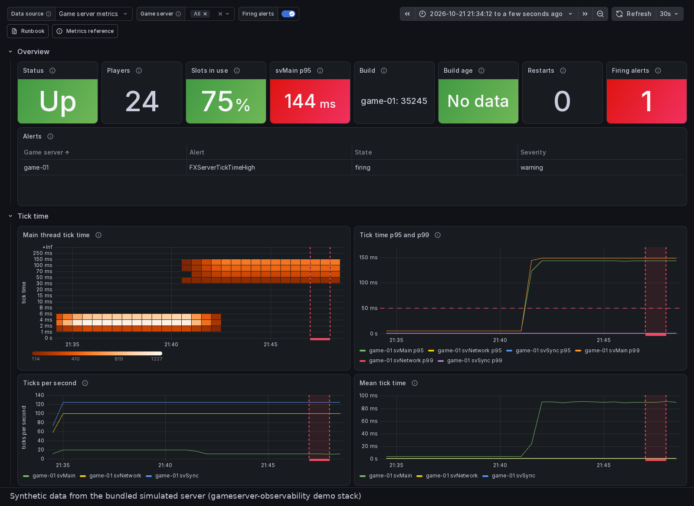
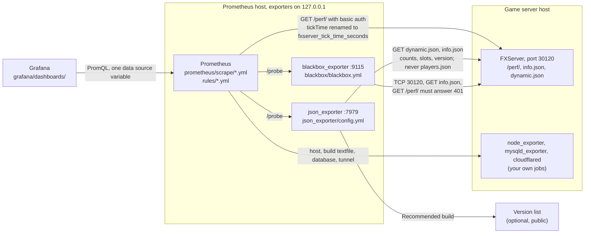

<!-- header:begin: the project page on luminare.tech drops this block, because the page has its own heading -->
<picture>
  <source media="(prefers-color-scheme: dark)" srcset="docs/brand/readme-header-dark.svg">
  <source media="(prefers-color-scheme: light)" srcset="docs/brand/readme-header-light.svg">
  
</picture>

<!-- byline:studio -->
*a [Luminare Development](https://luminare.tech/open-source/gameserver-observability/) open-source project*
<!-- /byline:studio -->
<!-- byline:personal
*by ItsPaulAT · [project page](https://luminare.tech/open-source/gameserver-observability/)*
/byline:personal -->
<!-- header:end -->

# gameserver-observability

Metrics, dashboards and alerts collected from outside the server process, for FiveM/RedM servers (FXServer).

[](https://github.com/luminare-dev/gameserver-observability/actions/workflows/ci.yml)
[](https://github.com/luminare-dev/gameserver-observability/releases)
[](LICENSE)
[](https://scorecard.dev/viewer/?uri=github.com/luminare-dev/gameserver-observability)



*Synthetic data from the bundled simulated server: the dashboard of the [demo stack](docs/demo.md)
while the simulated server's main thread ticks slowly and `FXServerTickTimeHigh` fires. No game
server and no players were involved.*

## Why

FXServer, the server of FiveM and RedM, serves performance metrics on `/perf/` and its status as
JSON (`info.json`, `dynamic.json`) on the game port. Turning them into alerts and dashboards
usually means writing scrape configs, PromQL and panels by hand, and it is easy to collect more
than needed, such as player names or identifiers. This pack does it from outside the server
process, with no resource running inside the game server and with player counts only. The
repository holds the scrape jobs, the json_exporter and blackbox_exporter modules, recording rules
and twelve alerts with a runbook section each, a Grafana dashboard with a copy for sharing, a
reference of every metric with how far it is verified, a fake server that CI scrapes through
the real exporters, and a demo stack that runs all of it against that fake server with Docker
Compose.

## Quickstart

On the host that runs Prometheus (details, the `/perf/` password and the exporter services:
[Installation](docs/install.md)). The exporter configs are installed only where none exists yet;
if an exporter already has one, merge this pack's modules into it instead
([Install](docs/install.md#install)):

```bash
git clone https://github.com/luminare-dev/gameserver-observability.git && cd gameserver-observability
sudo install -D -m 0644 prometheus/scrape/fxserver.yml /etc/prometheus/scrape/fxserver.yml
sudo install -D -m 0644 -t /etc/prometheus/rules rules/*.yml
test -e /etc/json_exporter/config.yml || sudo install -D -m 0644 json_exporter/config.yml /etc/json_exporter/config.yml
test -e /etc/blackbox_exporter/blackbox.yml || sudo install -D -m 0644 blackbox/blackbox.yml /etc/blackbox_exporter/blackbox.yml
```

Then set the targets and the `server` label in the scrape jobs, include them with
`scrape_config_files` and the rules with `rule_files`, set `sv_prometheusBasicAuthUser` and
`sv_prometheusBasicAuthPassword` on the game server and write the password into
`/etc/prometheus/secrets/fxserver_perf` ([Configuration](docs/configuration.md)). The dashboard
is installed on the Grafana host ([Dashboards](docs/install.md#dashboards)). There is no release
yet; once there is, check out its tag instead of `main`. To look at the dashboard and the alerts
first, without a game server, start the [demo stack](docs/demo.md) from the clone with
`docker compose -f demo/docker-compose.yml up -d` and open <http://127.0.0.1:3000/>.

## How it works



Prometheus scrapes `/perf/` itself, keeps only the tick-time histogram and renames it with a
`thread` label ([ADR 0010](docs/adr/0010-rename-tick-time-to-fxserver-tick-time-seconds.md)). For
the JSON endpoints and the probes it asks json_exporter and blackbox_exporter, which fetch the
server's URLs per scrape. Nothing runs inside the server process, and no series or label holds
data about a single player ([ADR 0009](docs/adr/0009-counts-only-from-the-status-endpoints.md)).
[Metrics reference](docs/metrics.md) lists every series and its source,
[cardinality budget](docs/cardinality.md) what it costs: 129 series per game server, plus 12
recorded ones.

The rules in `rules/` record the tick time's 95th and 99th percentile, mean and rate per server
and thread over one-minute windows
([ADR 0014](docs/adr/0014-tick-time-over-one-minute-windows.md)), and define twelve alerts, each
named by the game server's `server` label, with a severity and a link to its
[runbook](docs/runbook.md) section ([ADR 0015](docs/adr/0015-alerts-per-game-server.md)):

| Alert | Fires when |
|---|---|
| `FXServerTickTimeHigh` | `svMain` p95 above 50 ms for 5 minutes |
| `FXServerDown` | the game port or `info.json` does not answer for 2 minutes |
| `FXServerTargetDown` | a scrape of a running server fails for 10 minutes |
| `FXServerNoPlayersAfterRestart` | 0 players 30 minutes after a restart that players did not come back from ([ADR 0016](docs/adr/0016-restarts-from-tick-counter-resets.md)) |
| `FXServerPerfEndpointExposed` | `/perf/` answers without credentials |
| `FXServerAdminHostnameUnprotected`, `FXServerAdminHostnameProbeFailing` | the optional admin hostname probe sees no access protection, or fails |
| `FXServerArtifactOld`, `FXServerBuildBehindRecommended` | the build was switched on more than 8 weeks ago, or is older than the Recommended build of the last 14 days ([ADR 0017](docs/adr/0017-build-age-and-the-recommended-build.md)) |
| `HostDiskAlmostFull` | a disk is more than 85 % full |
| `MariaDBDown`, `MariaDBSlowQueries` | the database is down, or runs more than one slow query a minute |

The dashboard "Game server overview" (`grafana/dashboards/`) shows these series in six rows:
an overview (status, players, slots in use, `svMain` p95, build, build age, restarts, alerts),
tick time (a heatmap of the `svMain` histogram, p95 and p99 per thread, ticks per second, mean),
players, host, MariaDB, and probes and tunnel. Its variables pick the data source and the game
servers; the file stores no data source and no server name. `grafana/dashboards/shareable/` holds
a copy without variables for importing elsewhere ([ADR 0018](docs/adr/0018-dashboard-with-a-shareable-copy.md)). Grafana
provisioning files load it into a folder "Game server". `scripts/lint_dashboards.py` checks that
titles carry no platform or vendor mark, that no data source uid is stored, that every query
reads only metrics of the [metrics reference](docs/metrics.md), no label tied to a player and no
`instance`, that the copy matches, and parses every query with promtool
([ADR 0019](docs/adr/0019-dashboard-check-in-standard-library-python.md)).

Every pull request runs, besides the template's checks: the unit tests (including the fake
server, the pack check, the dashboard check and the shape of every rule) in `ci / lint-test`;
`promtool check rules`, the promtool rule tests (a case where each alert fires and one where it
must stay quiet), `promtool check config` and the privacy rules on the configs, and the dashboard
check with every query parsed by promtool in the `promtool` job
([ADR 0011](docs/adr/0011-pack-check-in-standard-library-python.md)); and in the `exporters` job
the pinned Prometheus, json_exporter and blackbox_exporter with the configs and the rules against
the fake server, checking names, labels, values, that `players.json` is never requested, and that
a tick-time spike and a stopped server raise the right alerts
([ADR 0012](docs/adr/0012-test-the-configs-against-a-fake-server.md)); and in the `demo-smoke`
job the [demo stack](docs/demo.md) (`demo/docker-compose.yml`), which runs the same files with the
fake server, the exporters, Prometheus and Grafana in containers pinned by digest, checking the
targets, the rules and the provisioned dashboard through their APIs
([ADR 0020](docs/adr/0020-demo-stack-in-one-network-namespace.md)). Merging the release pull
request tags the version and publishes a `git archive` of the tag with `SHA256SUMS`
([ADR 0005](docs/adr/0005-pack-layout-and-release-archive.md)).

What is in the repository today:

| Path | Content |
|---|---|
| `prometheus/scrape/` | `fxserver.yml` (jobs `fxserver_perf`, `fxserver_json`, `fxserver_blackbox`) and the optional `tunnel.yml` (`fxserver_tunnel`) and `versions.yml` (`fxserver_versions`) |
| `prometheus/prometheus.demo.yml` | the demo stack's main Prometheus config: the one of the installation guide |
| `json_exporter/`, `blackbox/` | the exporter modules |
| `rules/` | the recording rules and the alerts, in five files by the data they need |
| `grafana/` | the dashboard, its shareable copy in `dashboards/shareable/`, and the provisioning files for the dashboard folder and an optional data source |
| `demo/` | the demo stack (`docker-compose.yml`) and, in `fake-fxserver/`, the fake game server: synthetic data, basic auth on `/perf/`, a load knob for tick-time spikes |
| `scripts/` | `check_pack.py` (config checks), `lint_dashboards.py` (dashboard checks, and `--fix` writes the shareable copies), `smoke_exporters.py` (end-to-end run), `smoke_demo.py` (demo stack run), `test.sh` (the test command), `check_promtool.sh` (rule checks and rule tests), and the template's checks for wording, names, byline, workflow pins and the release archive |
| `tests/` | unit tests for the fake server, the pack check, the dashboard check, the rules, the demo stack, the scripts and this repository's setup; `tests/rules/` holds the promtool rule tests |
| `docs/` | metrics reference, cardinality budget, installation, configuration, demo stack, upgrade, troubleshooting, runbook (a section per alert), toolchain pins and the ADRs; `media/` holds the pictures of the demo stack |
| `.github/workflows/` | CI (`ci.yml` with the `promtool`, `exporters` and `demo-smoke` jobs), secret scan, pull request title check, release, OpenSSF Scorecard |

## Design decisions

The decisions behind this project are recorded as short ADRs in [docs/adr/](docs/adr/):

- [ADR 0001: Record architecture decisions](docs/adr/0001-record-architecture-decisions.md)
- [ADR 0002: Pin every action and downloaded tool](docs/adr/0002-pin-actions-and-downloaded-tools.md)
- [ADR 0003: Secret scanning with the gitleaks binary](docs/adr/0003-secret-scanning-with-the-gitleaks-binary.md)
- [ADR 0004: Draft releases with checksums and provenance](docs/adr/0004-draft-releases-with-checksums-and-provenance.md)
- [ADR 0005: Plain files in a fixed layout, released as the source archive](docs/adr/0005-pack-layout-and-release-archive.md)
  (why plain files instead of generated bundles or container images)
- [ADR 0006: promtool from the official release tarball](docs/adr/0006-promtool-from-the-official-release-tarball.md)
  (why the pinned tarball instead of a container image or a setup action)
- [ADR 0007: One test script with hash-pinned requirements](docs/adr/0007-one-test-script-with-hash-pinned-requirements.md)
  (why one script for CI, the release and local runs instead of inline commands)
- [ADR 0008: Extra secret rule for any cfxk_ token](docs/adr/0008-extra-secret-rule-for-any-cfxk-token.md)
  (why a broader license-key rule instead of the template's rules alone)
- [ADR 0009: Counts only, from the status endpoints](docs/adr/0009-counts-only-from-the-status-endpoints.md)
  (why `dynamic.json` instead of counting `players.json` or a resource inside the server)
- [ADR 0010: Rename tickTime to fxserver_tick_time_seconds](docs/adr/0010-rename-tick-time-to-fxserver-tick-time-seconds.md)
  (why renamed series at the scrape instead of the server's names or recorded copies)
- [ADR 0011: Pack check in standard-library Python](docs/adr/0011-pack-check-in-standard-library-python.md)
  (why its own YAML reader instead of PyYAML or the tools' checks alone)
- [ADR 0012: Test the configs against a fake server](docs/adr/0012-test-the-configs-against-a-fake-server.md)
  (why the real exporters against a fake instead of recorded files or config checks alone)
- [ADR 0013: Probed target in the instance label](docs/adr/0013-probed-target-in-the-instance-label.md)
  (why the probed URL or address instead of a fixed alias, and what shared views must leave out)
- [ADR 0014: Tick time over one-minute windows](docs/adr/0014-tick-time-over-one-minute-windows.md)
  (why one-minute instead of five-minute windows for the recorded percentiles, and their names)
- [ADR 0015: Alerts per game server](docs/adr/0015-alerts-per-game-server.md)
  (why alerts name the `server` label instead of keeping the source labels, and the two severities)
- [ADR 0016: Restarts from tick counter resets](docs/adr/0016-restarts-from-tick-counter-resets.md)
  (why the reset of the tick counter instead of a scrape gap or any empty period)
- [ADR 0017: Build age and the Recommended build](docs/adr/0017-build-age-and-the-recommended-build.md)
  (why the switch time and the public version list instead of release dates)
- [ADR 0018: Dashboard with a shareable copy](docs/adr/0018-dashboard-with-a-shareable-copy.md)
  (why a generated copy without variables instead of Grafana's export, and why no resources row)
- [ADR 0019: Dashboard check in standard-library Python](docs/adr/0019-dashboard-check-in-standard-library-python.md)
  (why a small query reader plus promtool instead of Grafana's linter or a PromQL package)
- [ADR 0020: Demo stack in one network namespace](docs/adr/0020-demo-stack-in-one-network-namespace.md)
  (why one shared namespace with the files as shipped instead of a compose network with copies of them)

## Supported versions

| Component | Tested with | Supported |
|---|---|---|
| Prometheus | 3.15.0 (`promtool check config`, and the `exporters` run) | 3.x; `scrape_config_files` needs 2.43 or newer |
| json_exporter | 0.8.0 | 0.8.0 (module format of that release) |
| blackbox_exporter | 0.29.0 | 0.29.0 |
| FXServer | build 35245, read in its source code; not yet run against a live server | the endpoints of build 35245 |
| promtool (rule checks and rule tests in CI) | 3.15.0 | 3.15.0 (pinned in `ci.yml`) |
| node_exporter, mysqld_exporter (host, build and database alerts) | node_exporter 1.12.1 and mysqld_exporter 0.20.0 with MariaDB 11.8.9 in the dashboard check; the rules are tested with promtool on the documented metric names | the versions you run, scraped by your own jobs |
| Grafana (dashboard) | 13.2.4 (provisioning, every query, the import of the shareable copy) | 13.2.4; the dashboard uses schema 42, the latest of 13.2.4, and other versions have not been tried |
| cloudflared (tunnel panels) | 2026.10.2 in the dashboard check | the versions you run, scraped by your own job |
| Python (scripts, fake server and tests) | 3.10.22, 3.12.15, 3.13.16 (the fake server in the demo stack), 3.14.3 | 3.10 or newer |
| Docker Engine with Compose (demo stack only) | Docker Engine 29.2.1 with Docker Compose 5.0.2 | a Docker with the Compose plugin; CI uses the one of GitHub's `ubuntu-24.04` runner |

Fixes go into the latest minor release only. See the
[security policy](https://github.com/luminare-dev/.github/blob/main/SECURITY.md) for reporting.

## Limitations

- No Alertmanager configuration: the alerts are evaluated and shown in Prometheus and on the
  dashboard, and routing them is left to your Alertmanager.
- The pictures show synthetic data from the bundled simulated server in the
  [demo stack](docs/demo.md), not a real game server under load; that needs a server with a
  license key. The demo has no node_exporter, mysqld_exporter, cloudflared or admin hostname, so
  its Host, MariaDB, admin hostname and tunnel panels and its Build age stay empty.
- Every query of the dashboard was run on Grafana 13.2.4 here, by hand (see [Results](#results)).
  CI checks its JSON and parses every query with promtool, and the `demo-smoke` job provisions it
  on Grafana 13.2.4 and runs one query through the data source, but no CI job draws its panels.
  It has no row for the game server's resources (scripts and assets), because the pack does not
  collect the resource list ([ADR 0018](docs/adr/0018-dashboard-with-a-shareable-copy.md)).
- The host, build and database alerts read node_exporter and mysqld_exporter, and the dashboard
  also cloudflared; this pack does not ship them or run them in CI, so the alerts on them are
  tested with promtool only. The build alerts need the textfile metrics of the `luminare.gameserver`
  collection's `fxserver` role (or a file of the same shape), and `FXServerBuildBehindRecommended`
  the optional version list job, which no alert watches itself. In the dashboard check,
  cloudflared had no reachable edge and passed no requests, so its request panel was seen at 0
  only.
- The end-to-end run checks the rules on live data for a healthy server, a tick-time spike and a
  stopped server. Every other firing case, among them the alerts with long windows (no players
  after a restart, the build alerts), is tested with promtool only.
- Nothing has been run against a real FXServer; that needs a server with a license key. The
  fields, buckets and access rules were read in the source code of build 35245 and tested against
  the fake server. Not verified on a live server: the exact version string (and so the `build`
  label), the rate limits, and the `/perf/` answer without credentials
  ([metrics reference](docs/metrics.md#how-far-each-metric-is-verified)).
- The admin hostname probe (`prometheus/scrape/tunnel.yml`) has not run against a real
  access-protected hostname, and it is not part of the `exporters` run.
- There is no module for txAdmin's status endpoint, because its fields have not been checked.
- There is no release yet. Build provenance attestations are only created for public
  repositories, so the first release is made after the repository is public.
- The `promtool`, `exporters` and `demo-smoke` jobs are not required checks yet (`ci / lint-test`,
  `secrets / gitleaks`, `pr / pr-title`, `DCO`); they are added to the ruleset after they have run
  on a pull request.

## Results

| What | Value | How it was measured |
|---|---|---|
| End-to-end run | all 33 checks passed in 187 s: 7 of 7 targets up, the 8 documented `fxserver_*` metrics with the fake server's and the synthetic version list's values, no `players.json` request, all 5 rule files loaded and every rule evaluated without an error, the 4 recorded series per thread, no alert while healthy, `FXServerTickTimeHigh` pending 32 s after a 90 ms spike, `FXServerDown` pending 30 s after the fake server stopped while `FXServerTargetDown` stayed quiet | `python3 -I scripts/smoke_exporters.py` with Prometheus 3.15.0, json_exporter 0.8.0 and blackbox_exporter 0.29.0 installed by the steps of the `exporters` job, in a `python:3.12-slim` container (the runner's Python) without network, 2026-10-21 |
| Broken configs and rules caught | 4 of 4 | `scripts/smoke_exporters.py` on four changed copies, in a `python:3.13-slim` container: without the `labeldrop` of `name` (3 checks failed), with a wrong json_exporter path (2 failed), `FXServerDown` with wrong module names (1 failed: never pending) and `FXServerTargetDown` without its `unless` clause (1 failed: pending while the server was down), 2026-10-21 |
| Rule tests | 82 cases in 39 test groups passed: every one of the 12 alerts fires in at least one (19 in all) and stays quiet in at least three (63 in all); 11 checks of recorded values | `bash scripts/check_promtool.sh` with promtool 3.15.0 (`promtool check rules --lint=all --lint-fatal`: 16 rules in 5 files, then `promtool test rules` on 9 files), 2026-10-21 |
| Series per game server | 129 (99 samples per scrape round and 30 per-target series), plus 12 recorded series | `scrape_samples_post_metric_relabeling` and the recorded series in the end-to-end run ([cardinality budget](docs/cardinality.md)), 2026-10-21 |
| Version list module | `fxserver_recommended_build` 35245, the Recommended build listed that day | json_exporter 0.8.0 with `json_exporter/config.yml`, module `fxserver_versions`, against the real version list, 2026-10-21 |
| Pack check | 0 findings in 6 files; `promtool check config --lint=all` passed for 4 files (the three scrape files and the demo stack's main config) | `python3 scripts/check_pack.py --require-promtool` with promtool 3.15.0, 2026-10-22 |
| YAML reader against PyYAML | 0 files read differently out of 214 (52 read alike, 162 refused) | the reader of `scripts/check_pack.py` and PyYAML 6.0.3 on the YAML files of this project's repositories and of installed Python packages, 2026-10-21 |
| Installation steps | 7 of 7 targets up, 5 rule groups evaluated without an error, no alert active | the commands of [Installation](docs/install.md), with the optional version list job, as root in a `python:3.13-slim` container against the fake server, 2026-10-21 |
| Dashboard on a fresh Grafana | the folder "Game server" with the dashboard and the data source "Game server metrics" provisioned from the repository's files alone; 37 of 37 queries (36 panel queries and the alert annotation) returned data; the shareable copy imported with one data source input and no variable left, and 37 of 37 of its queries returned data; both opened in a browser with every panel drawn | Grafana 13.2.4 (`grafana/grafana:13.2.4` container, the steps of [Dashboards](docs/install.md#dashboards)) on Prometheus 3.15.0 with the pack's configs and rules, json_exporter 0.8.0, blackbox_exporter 0.29.0, node_exporter 1.12.1, mysqld_exporter 0.20.0 with MariaDB 11.8.9 and cloudflared 2026.10.2, against the fake server and a local HTTPS stand-in for the admin hostname; queries through Grafana's query API over 30 minutes, then screenshots with headless Chromium, 2026-10-21 |
| Dashboard schema | 42, the latest of Grafana 13.2.4 | a dashboard saved with schema 30 came back as 42 from Grafana's dashboard API (`dashboard.grafana.app/v1beta1`), 2026-10-21 |
| Dashboard removal | with only the dashboard files removed the dashboard stayed; with the provisioning file removed too it was gone after a restart (its empty folder stayed); the data source was gone after a restart with a `deleteDatasources` file | the commands of [Uninstall](docs/install.md#uninstall) for Grafana, on a second fresh `grafana/grafana:13.2.4` container, 2026-10-21 |
| Dashboard check | 0 findings in 2 files; 75 queries (37 per file and the variable query) passed `promtool check rules` | `python3 scripts/lint_dashboards.py --require-promtool` with promtool 3.15.0, 2026-10-21 |
| Demo stack | 13 of 13 checks passed in 63 s, then the stack was removed with no container, network or volume left: 6 of 6 targets up, the 3 probes succeeded (`/perf/` refused without the password), 3 players in Prometheus and through Grafana's data source, no `players.json` request, 16 rules in 5 files evaluated without an error, no alert active, the dashboard provisioned read-only in the folder "Game server", and a sign-in refused | `python3 -I scripts/smoke_demo.py` with Docker Engine 29.2.1 and Docker Compose 5.0.2, the images already pulled, 2026-10-22 |
| Broken demo caught | 3 checks failed and the stack was still removed: with `/perf/` left open on the simulated server, the `/perf/` probe, the count of refused requests and the quiet alerts | `scripts/smoke_demo.py --timeout 60` with the simulated server's two password flags taken out of the compose file for the run, 2026-10-22 |
| Demo load spike | `FXServerTickTimeHigh` pending 52 s after the simulated server's `svMain` ticks went to 90 ms on average, firing 5 minutes later (`svMain` p95 144 ms, 11 ticks per second instead of 20), and gone about 80 s after the spike ended; with the simulated server stopped, `FXServerDown` pending after 48 s and firing 2 minutes later, gone within 30 s of the restart, which the Restarts panel's query counted | the demo stack with the scenario of [Pictures](docs/demo.md#pictures), times from Prometheus' alerts API and `ALERTS` series, 2026-10-21 and 2026-10-22 |
| Pictures | `docs/media/dashboard.png` (1600 × 1169) and `docs/media/dashboard-spike.gif` (45 frames, 1000 × 573), both labelled as synthetic data; they show the `server` label `game-01` and no host name or address, and carry no metadata | headless Chromium 156 driven by Playwright 1.64.0 on the demo stack; the PNG and the GIF's first, 31st and last frames looked at, and the metadata of both read with Pillow 13.0.0; the dashboard check refuses queries on `instance`, the only label that holds an address, 2026-10-21 ([how](docs/demo.md#pictures)) |
| Unit tests | 269 run, 0 failed, 1 skipped; 25 for the fake server, 39 for the pack check, 45 for the dashboard check, 30 for this repository's setup, 19 for the rules, 14 for the demo stack | `bash scripts/test.sh` with gitleaks 8.30.1, markdownlint-cli2 0.23.2 and promtool 3.15.0 on the `PATH`, Python 3.14.3, 2026-10-22 (the skipped test applies only to the template repository) |
| Unit tests, CI mode | 269 run, 0 failed, 5 skipped | `CI=true bash scripts/test.sh` without gitleaks, markdownlint-cli2 and promtool on the `PATH`, Python 3.14.3, 2026-10-22: the script downloaded gitleaks 8.30.1 and checked its sha256, so the secret-rule tests ran |
| Unit tests, other Pythons | 269 run, 0 failed, 13 skipped on each | `bash scripts/test.sh` on Python 3.10.22 and 3.12.15 (`python:3.10-slim`, `python:3.12-slim` plus git, without gitleaks, markdownlint-cli2 and promtool), 2026-10-22 |
| Secret scan | 0 leaks in 6 commits (the history of this branch) | `gitleaks git --redact --config .gitleaks.toml --log-opts=HEAD .`, gitleaks 8.30.1, 2026-10-22 |
| Wording, name and placeholder check | 0 findings, 0 warnings | `python3 scripts/forbidden_words.py` in publish mode, 2026-10-22 |

## Documentation and links

- [Metrics reference](docs/metrics.md) · [Cardinality budget](docs/cardinality.md) ·
  [Installation](docs/install.md) · [Configuration](docs/configuration.md) ·
  [Upgrade](docs/upgrade.md) · [Troubleshooting](docs/troubleshooting.md) ·
  [Runbook](docs/runbook.md) · [Demo stack](docs/demo.md) · [Toolchain and pins](docs/toolchain.md) ·
  [ADRs](docs/adr/)
- Development: `bash scripts/test.sh` is the one command CI runs for the tests,
  `python3 scripts/check_pack.py` checks the configs, `python3 scripts/smoke_exporters.py` runs
  them end to end against the fake server, `python3 scripts/smoke_demo.py` starts, checks and
  removes the demo stack, and `bash scripts/check_promtool.sh` checks the rules
  (tools and versions: [Installation](docs/install.md), [Toolchain and pins](docs/toolchain.md))
- [Changelog](CHANGELOG.md) and [releases](https://github.com/luminare-dev/gameserver-observability/releases)
  (each release has `SHA256SUMS` and a build provenance attestation)
- [Contributing](https://github.com/luminare-dev/.github/blob/main/CONTRIBUTING.md) ·
  [Code of conduct](https://github.com/luminare-dev/.github/blob/main/CODE_OF_CONDUCT.md) ·
  [Security](https://github.com/luminare-dev/.github/blob/main/SECURITY.md) ·
  [Support](https://github.com/luminare-dev/.github/blob/main/SUPPORT.md)
- Project page: <https://luminare.tech/open-source/gameserver-observability/>

<!-- fxserver:begin -->
## Not affiliated

Not affiliated with or endorsed by Cfx.re, Rockstar Games or Take-Two. FiveM, RedM and FXServer
are named only to describe what this project works with.

<!-- fxserver:end -->

## Licence

[Apache-2.0](LICENSE). The licence covers the code only: the project name, logo, header images
and `docs/brand/` are not licensed (see [NOTICE](NOTICE)).

<!-- byline:studio -->
*a [Luminare Development](https://luminare.tech/open-source/gameserver-observability/) open-source project*
<!-- /byline:studio -->
<!-- byline:personal
*by ItsPaulAT · [project page](https://luminare.tech/open-source/gameserver-observability/)*
/byline:personal -->
