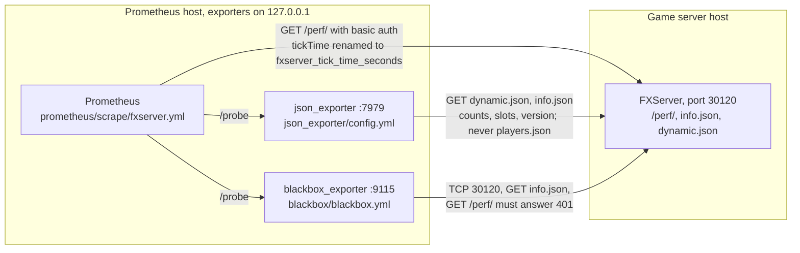

<!-- header:begin: the project page on luminare.tech drops this block, because the page has its own heading -->
<picture>
  <source media="(prefers-color-scheme: dark)" srcset="docs/brand/readme-header-dark.svg">
  <source media="(prefers-color-scheme: light)" srcset="docs/brand/readme-header-light.svg">
  
</picture>

<!-- byline:studio -->
*a [Luminare Development](https://luminare.tech/open-source/gameserver-observability/) open-source project*
<!-- /byline:studio -->
<!-- byline:personal
*by ItsPaulAT · [project page](https://luminare.tech/open-source/gameserver-observability/)*
/byline:personal -->
<!-- header:end -->

# gameserver-observability

Metrics, dashboards and alerts collected from outside the server process, for FiveM/RedM servers (FXServer).

[](https://github.com/luminare-dev/gameserver-observability/actions/workflows/ci.yml)
[](https://github.com/luminare-dev/gameserver-observability/releases)
[](LICENSE)
[](https://scorecard.dev/viewer/?uri=github.com/luminare-dev/gameserver-observability)

## Why

FXServer, the server of FiveM and RedM, serves performance metrics on `/perf/` and its status as
JSON (`info.json`, `dynamic.json`) on the game port. Turning them into alerts and dashboards
usually means writing scrape configs, PromQL and panels by hand, and it is easy to collect more
than needed, such as player names or identifiers. This pack does it from outside the server
process, with no resource running inside the game server and with player counts only. The
repository holds the scrape jobs, the json_exporter and blackbox_exporter modules, a reference of
every metric with how far it is verified, and a fake server that CI scrapes through the real
exporters; the recording and alerting rules and the dashboards are not in it yet (see
[Limitations](#limitations)).

## Quickstart

On the host that runs Prometheus (details, the `/perf/` password and the exporter services:
[Installation](docs/install.md)). The exporter configs are installed only where none exists yet;
if an exporter already has one, merge this pack's modules into it instead
([Install](docs/install.md#install)):

```bash
git clone https://github.com/luminare-dev/gameserver-observability.git
cd gameserver-observability
sudo install -D -m 0644 prometheus/scrape/fxserver.yml /etc/prometheus/scrape/fxserver.yml
test -e /etc/json_exporter/config.yml || sudo install -D -m 0644 json_exporter/config.yml /etc/json_exporter/config.yml
test -e /etc/blackbox_exporter/blackbox.yml || sudo install -D -m 0644 blackbox/blackbox.yml /etc/blackbox_exporter/blackbox.yml
```

Then set the targets and the `server` label in the scrape jobs, include them with
`scrape_config_files`, set `sv_prometheusBasicAuthUser` and `sv_prometheusBasicAuthPassword` on the
game server and write the password into `/etc/prometheus/secrets/fxserver_perf`
([Configuration](docs/configuration.md)). There is no release yet; once there is, check out its
tag instead of `main`.

## How it works



Prometheus scrapes `/perf/` itself, keeps only the tick-time histogram and renames it with a
`thread` label ([ADR 0010](docs/adr/0010-rename-tick-time-to-fxserver-tick-time-seconds.md)). For
the JSON endpoints and the probes it asks json_exporter and blackbox_exporter, which fetch the
server's URLs per scrape. Nothing runs inside the server process, and no series or label holds
data about a single player ([ADR 0009](docs/adr/0009-counts-only-from-the-status-endpoints.md)).
[Metrics reference](docs/metrics.md) lists every series and its source,
[cardinality budget](docs/cardinality.md) what it costs: 129 series per game server.

Every pull request runs, besides the template's checks: the unit tests (including the fake
server and the pack check) in `ci / lint-test`; `promtool check config` and the privacy rules on
the configs in the `promtool` job ([ADR 0011](docs/adr/0011-pack-check-in-standard-library-python.md));
and in the `exporters` job the pinned Prometheus, json_exporter and blackbox_exporter against the
fake server, checking names, labels, values and that `players.json` is never requested
([ADR 0012](docs/adr/0012-test-the-configs-against-a-fake-server.md)). Merging the release pull
request tags the version and publishes a `git archive` of the tag with `SHA256SUMS`
([ADR 0005](docs/adr/0005-pack-layout-and-release-archive.md)).

What is in the repository today:

| Path | Content |
|---|---|
| `prometheus/scrape/` | `fxserver.yml` (jobs `fxserver_perf`, `fxserver_json`, `fxserver_blackbox`) and the optional `tunnel.yml` (`fxserver_tunnel`) |
| `json_exporter/`, `blackbox/` | the exporter modules |
| `demo/fake-fxserver/` | the fake game server: synthetic data, basic auth on `/perf/`, a load knob for tick-time spikes |
| `scripts/` | `check_pack.py` (config checks), `smoke_exporters.py` (end-to-end run), `test.sh` (the test command), `check_promtool.sh` (rule checks), and the template's checks for wording, names, byline, workflow pins and the release archive |
| `tests/` | unit tests for the fake server, the pack check, the scripts and this repository's setup |
| `docs/` | metrics reference, cardinality budget, installation, configuration, upgrade, troubleshooting, runbook, toolchain pins and the ADRs |
| `.github/workflows/` | CI (`ci.yml` with the `promtool` and `exporters` jobs), secret scan, pull request title check, release, OpenSSF Scorecard |

## Design decisions

The decisions behind this project are recorded as short ADRs in [docs/adr/](docs/adr/):

- [ADR 0001: Record architecture decisions](docs/adr/0001-record-architecture-decisions.md)
- [ADR 0002: Pin every action and downloaded tool](docs/adr/0002-pin-actions-and-downloaded-tools.md)
- [ADR 0003: Secret scanning with the gitleaks binary](docs/adr/0003-secret-scanning-with-the-gitleaks-binary.md)
- [ADR 0004: Draft releases with checksums and provenance](docs/adr/0004-draft-releases-with-checksums-and-provenance.md)
- [ADR 0005: Plain files in a fixed layout, released as the source archive](docs/adr/0005-pack-layout-and-release-archive.md)
  (why plain files instead of generated bundles or container images)
- [ADR 0006: promtool from the official release tarball](docs/adr/0006-promtool-from-the-official-release-tarball.md)
  (why the pinned tarball instead of a container image or a setup action)
- [ADR 0007: One test script with hash-pinned requirements](docs/adr/0007-one-test-script-with-hash-pinned-requirements.md)
  (why one script for CI, the release and local runs instead of inline commands)
- [ADR 0008: Extra secret rule for any cfxk_ token](docs/adr/0008-extra-secret-rule-for-any-cfxk-token.md)
  (why a broader license-key rule instead of the template's rules alone)
- [ADR 0009: Counts only, from the status endpoints](docs/adr/0009-counts-only-from-the-status-endpoints.md)
  (why `dynamic.json` instead of counting `players.json` or a resource inside the server)
- [ADR 0010: Rename tickTime to fxserver_tick_time_seconds](docs/adr/0010-rename-tick-time-to-fxserver-tick-time-seconds.md)
  (why renamed series at the scrape instead of the server's names or recorded copies)
- [ADR 0011: Pack check in standard-library Python](docs/adr/0011-pack-check-in-standard-library-python.md)
  (why its own YAML reader instead of PyYAML or the tools' checks alone)
- [ADR 0012: Test the configs against a fake server](docs/adr/0012-test-the-configs-against-a-fake-server.md)
  (why the real exporters against a fake instead of recorded files or config checks alone)
- [ADR 0013: Probed target in the instance label](docs/adr/0013-probed-target-in-the-instance-label.md)
  (why the probed URL or address instead of a fixed alias, and what shared views must leave out)

## Supported versions

| Component | Tested with | Supported |
|---|---|---|
| Prometheus | 3.15.0 (`promtool check config`, and the `exporters` run) | 3.x; `scrape_config_files` needs 2.43 or newer |
| json_exporter | 0.8.0 | 0.8.0 (module format of that release) |
| blackbox_exporter | 0.29.0 | 0.29.0 |
| FXServer | build 35245, read in its source code; not yet run against a live server | the endpoints of build 35245 |
| promtool (rule checks in CI) | 3.15.0 | 3.15.0 (pinned in `ci.yml`) |
| Python (scripts, fake server and tests) | 3.10.22, 3.12.15, 3.14.3 | 3.10 or newer |

Fixes go into the latest minor release only. See the
[security policy](https://github.com/luminare-dev/.github/blob/main/SECURITY.md) for reporting.

## Limitations

- No recording or alerting rules, dashboards or demo stack yet. The `promtool` job and the release
  archive are set up for rules; today the job finds no rule files and says so.
- Nothing has been run against a real FXServer; that needs a server with a license key. The
  fields, buckets and access rules were read in the source code of build 35245 and tested against
  the fake server. Not verified on a live server: the exact version string (and so the `build`
  label), the rate limits, and the `/perf/` answer without credentials
  ([metrics reference](docs/metrics.md#how-far-each-metric-is-verified)).
- The admin hostname probe (`prometheus/scrape/tunnel.yml`) has not run against a real
  access-protected hostname, and it is not part of the `exporters` run.
- There is no module for txAdmin's status endpoint, because its fields have not been checked.
- There is no release yet. Build provenance attestations are only created for public
  repositories, so the first release is made after the repository is public.
- The `promtool` and `exporters` jobs are not required checks yet (`ci / lint-test`,
  `secrets / gitleaks`, `pr / pr-title`, `DCO`); they are added to the ruleset after they have run
  on a pull request.

## Results

| What | Value | How it was measured |
|---|---|---|
| End-to-end run | all 20 checks passed in 34 s: 6 of 6 targets up, the 7 documented `fxserver_*` metrics with the fake server's values, no `players.json` request | `python3 -I scripts/smoke_exporters.py` with Prometheus 3.15.0, json_exporter 0.8.0 and blackbox_exporter 0.29.0 installed by the steps of the `exporters` job, in a `python:3.12-slim` container (the runner's Python) without network, 2026-10-21 |
| Broken configs caught | 2 of 2 | `scripts/smoke_exporters.py` on two changed copies of the configs, in a `python:3.13-slim` container: without the `labeldrop` of `name` (3 checks failed) and with a wrong json_exporter path (2 checks failed), 2026-10-21 |
| Series per game server | 129 (99 samples per scrape round and 30 per-target series) | `scrape_samples_post_metric_relabeling` in the end-to-end run ([cardinality budget](docs/cardinality.md)), 2026-10-21 |
| Pack check | 0 findings in 4 files; `promtool check config --lint=all` passed for 2 files | `python3 scripts/check_pack.py --require-promtool` with promtool 3.15.0, 2026-10-21 |
| YAML reader against PyYAML | 0 files read differently out of 214 (52 read alike, 162 refused) | the reader of `scripts/check_pack.py` and PyYAML 6.0.3 on the YAML files of this project's repositories and of installed Python packages, 2026-10-21 |
| Installation steps | 6 of 6 targets up | the commands of [Installation](docs/install.md) as root in a `python:3.13-slim` container against the fake server, 2026-10-21 |
| Unit tests | 187 run, 0 failed, 1 skipped; 25 for the fake server, 38 for the pack check, 27 for this repository's setup | `bash scripts/test.sh` with gitleaks 8.30.1, markdownlint-cli2 0.23.2 and promtool 3.15.0 on the `PATH`, Python 3.14.3, 2026-10-21 (the skipped test applies only to the template repository) |
| Unit tests, CI mode | 187 run, 0 failed, 3 skipped | `CI=true bash scripts/test.sh` without gitleaks, markdownlint-cli2 and promtool on the `PATH`, Python 3.14.3, 2026-10-21: the script downloaded gitleaks 8.30.1 and checked its sha256, so the secret-rule tests ran |
| Unit tests, other Pythons | 187 run, 0 failed, 11 skipped on each | `bash scripts/test.sh` on Python 3.10.22 and 3.12.15 (`python:3.10-slim`, `python:3.12-slim` plus git, without gitleaks, markdownlint-cli2 and promtool), 2026-10-21 |
| Secret scan | 0 leaks in 3 commits | `gitleaks git --redact --config .gitleaks.toml .`, gitleaks 8.30.1, 2026-10-21 |
| Wording, name and placeholder check | 0 findings, 0 warnings | `python3 scripts/forbidden_words.py` in publish mode, 2026-10-21 |

## Documentation and links

- [Metrics reference](docs/metrics.md) · [Cardinality budget](docs/cardinality.md) ·
  [Installation](docs/install.md) · [Configuration](docs/configuration.md) ·
  [Upgrade](docs/upgrade.md) · [Troubleshooting](docs/troubleshooting.md) ·
  [Runbook](docs/runbook.md) · [Toolchain and pins](docs/toolchain.md) · [ADRs](docs/adr/)
- Development: `bash scripts/test.sh` is the one command CI runs for the tests,
  `python3 scripts/check_pack.py` checks the configs, `python3 scripts/smoke_exporters.py` runs
  them end to end against the fake server, and `bash scripts/check_promtool.sh` checks the rules
  (tools and versions: [Installation](docs/install.md), [Toolchain and pins](docs/toolchain.md))
- [Changelog](CHANGELOG.md) and [releases](https://github.com/luminare-dev/gameserver-observability/releases)
  (each release has `SHA256SUMS` and a build provenance attestation)
- [Contributing](https://github.com/luminare-dev/.github/blob/main/CONTRIBUTING.md) ·
  [Code of conduct](https://github.com/luminare-dev/.github/blob/main/CODE_OF_CONDUCT.md) ·
  [Security](https://github.com/luminare-dev/.github/blob/main/SECURITY.md) ·
  [Support](https://github.com/luminare-dev/.github/blob/main/SUPPORT.md)
- Project page: <https://luminare.tech/open-source/gameserver-observability/>

<!-- fxserver:begin -->
## Not affiliated

Not affiliated with or endorsed by Cfx.re, Rockstar Games or Take-Two. FiveM, RedM and FXServer
are named only to describe what this project works with.

<!-- fxserver:end -->

## Licence

[Apache-2.0](LICENSE). The licence covers the code only: the project name, logo, header images
and `docs/brand/` are not licensed (see [NOTICE](NOTICE)).

<!-- byline:studio -->
*a [Luminare Development](https://luminare.tech/open-source/gameserver-observability/) open-source project*
<!-- /byline:studio -->
<!-- byline:personal
*by ItsPaulAT · [project page](https://luminare.tech/open-source/gameserver-observability/)*
/byline:personal -->
