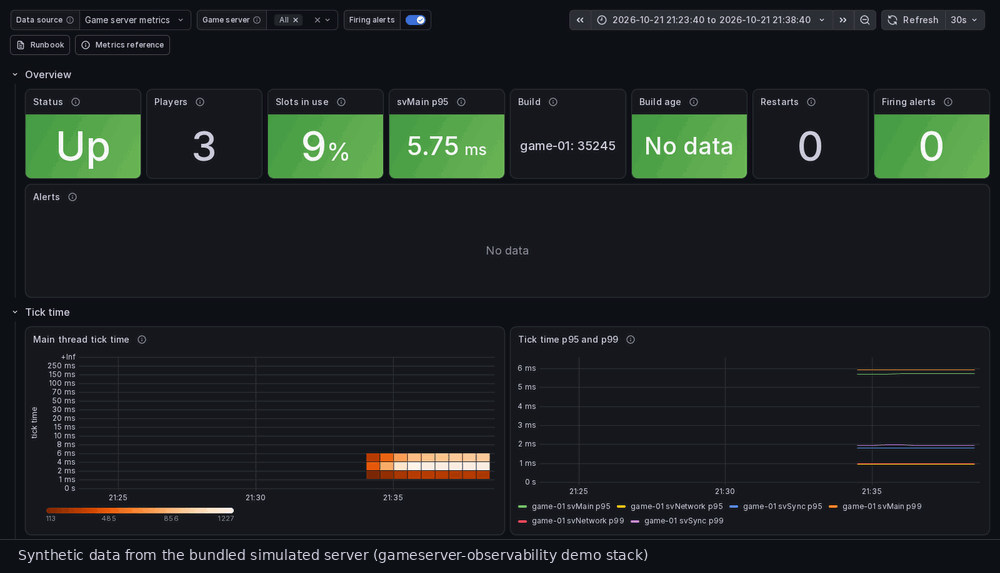

<!-- header:begin: the project page on luminare.tech drops this block, because the page has its own heading -->
<picture>
  <source media="(prefers-color-scheme: dark)" srcset="docs/brand/readme-header-dark.svg">
  <source media="(prefers-color-scheme: light)" srcset="docs/brand/readme-header-light.svg">
  
</picture>

<!-- byline:studio -->
*a [Luminare Development](https://luminare.tech/open-source/gameserver-observability/) open-source project*
<!-- /byline:studio -->
<!-- byline:personal
*by ItsPaulAT · [project page](https://luminare.tech/open-source/gameserver-observability/)*
/byline:personal -->
<!-- header:end -->

# gameserver-observability

Metrics, dashboards and alerts collected from outside the server process, for FiveM/RedM servers (FXServer).

[](https://github.com/luminare-dev/gameserver-observability/actions/workflows/ci.yml)
[](https://github.com/luminare-dev/gameserver-observability/releases)
[](LICENSE)
[](https://scorecard.dev/viewer/?uri=github.com/luminare-dev/gameserver-observability)



*Synthetic data from the [demo stack](docs/demo.md): a simulated tick-time spike that fires
`FXServerTickTimeHigh`. No real game server or players.*

Nothing runs inside the game server: Prometheus scrapes its `/perf/` endpoint and reads
`info.json` and `dynamic.json` through json_exporter and blackbox_exporter. Only counts are
collected, never player names or identifiers.

## Quickstart

Try it without a game server: the [demo stack](docs/demo.md) runs the pack against a bundled
simulated server. It needs Docker with Compose and the ports 3000, 9090 and 30120 on 127.0.0.1.

```bash
git clone https://github.com/luminare-dev/gameserver-observability.git
cd gameserver-observability
docker compose -f demo/docker-compose.yml up -d
curl -fsS -X POST -d '{"main_tick_ms": 90, "for_seconds": 600}' http://127.0.0.1:30120/fake/control
docker compose -f demo/docker-compose.yml down -v
```

Grafana is at <http://127.0.0.1:3000/> (no sign-in), Prometheus at <http://127.0.0.1:9090/>. The
`curl` call makes the main thread tick slowly for 10 minutes, so `FXServerTickTimeHigh` goes
pending within a minute and fires 5 minutes later.

For a real server, follow [Installation](docs/install.md). Use a release tag; `main` can hold
unreleased changes.

## How it works

| Path | Content |
|---|---|
| `prometheus/scrape/` | scrape jobs: `fxserver.yml`, and the optional `tunnel.yml` and `versions.yml` |
| `json_exporter/`, `blackbox/` | exporter modules |
| `rules/` | recording rules and alerts |
| `grafana/` | the dashboard "Game server overview", a copy without variables for sharing, provisioning files |
| `demo/` | the demo stack and the fake game server |

The alerts carry the `server` label, a severity and a link to their [runbook](docs/runbook.md)
section. Routing them is up to your own Alertmanager
([example](docs/configuration.md#send-the-alerts-to-alertmanager)).

| Alert | Fires when |
|---|---|
| `FXServerTickTimeHigh` | `svMain` p95 above 50 ms for 5 minutes |
| `FXServerDown` | the game port or `info.json` does not answer for 2 minutes |
| `FXServerTargetDown` | a scrape of a running server fails for 10 minutes |
| `FXServerNoPlayersAfterRestart` | 0 players 30 minutes after a restart that players did not come back from |
| `FXServerPerfEndpointExposed` | `/perf/` answers without credentials |
| `FXServerAdminHostnameUnprotected`, `FXServerAdminHostnameProbeFailing` | the optional admin hostname probe sees no access protection, or fails |
| `FXServerArtifactOld`, `FXServerBuildBehindRecommended` | the build was switched on more than 8 weeks ago, or is older than the Recommended build of the last 14 days |
| `HostDiskAlmostFull` | a disk is more than 85 % full |
| `MariaDBDown`, `MariaDBSlowQueries` | the database is down, or runs more than one slow query a minute |

The host, build and database alerts need your own node_exporter and mysqld_exporter jobs
([configuration](docs/configuration.md#host-and-database-jobs)).

## Supported versions

Tested with Prometheus 3.15.0, json_exporter 0.8.0, blackbox_exporter 0.29.0, Grafana 13.2.4 and
Python 3.10 or newer for the scripts. Prometheus needs 2.43 or newer for `scrape_config_files`.
FXServer builds 35245 to 37692, checked against their source code.

## Limitations

- Not yet run against a real, keyed FXServer; the endpoints were read in the server's source
  code and are tested against the fake server. The pictures show synthetic data only.
- No Alertmanager configuration and no grafana.com listing.

## Documentation and links

- [Installation](docs/install.md) · [Configuration](docs/configuration.md) ·
  [Upgrade](docs/upgrade.md) · [Troubleshooting](docs/troubleshooting.md) ·
  [Runbook](docs/runbook.md) · [Metrics](docs/metrics.md) · [Demo stack](docs/demo.md)
- Tests: `bash scripts/test.sh` (what CI runs)
- [Changelog](CHANGELOG.md) and [releases](https://github.com/luminare-dev/gameserver-observability/releases)
- [Contributing](https://github.com/luminare-dev/.github/blob/main/CONTRIBUTING.md) ·
  [Code of conduct](https://github.com/luminare-dev/.github/blob/main/CODE_OF_CONDUCT.md) ·
  [Security](https://github.com/luminare-dev/.github/blob/main/SECURITY.md) ·
  [Support](https://github.com/luminare-dev/.github/blob/main/SUPPORT.md)

<!-- fxserver:begin -->
## Not affiliated

Not affiliated with or endorsed by Cfx.re, Rockstar Games or Take-Two. FiveM, RedM and FXServer
are named only to describe what this project works with.

<!-- fxserver:end -->

## Licence

[Apache-2.0](LICENSE). The licence covers the code only: the project name, logo, header images
and `docs/brand/` are not licensed (see [NOTICE](NOTICE)).

<!-- byline:studio -->
*a [Luminare Development](https://luminare.tech/open-source/gameserver-observability/) open-source project*
<!-- /byline:studio -->
<!-- byline:personal
*by ItsPaulAT · [project page](https://luminare.tech/open-source/gameserver-observability/)*
/byline:personal -->
